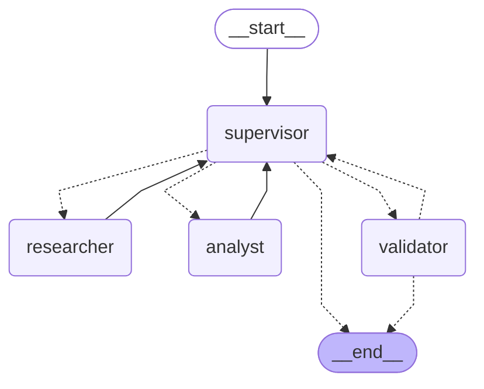

# Pre-entrega 6: Orquestador Multi-Agente Especializado (Presupuesto PC Gaming)

Implementación de un orquestador multi-agente con topología jerárquica en LangGraph. El sistema resuelve consultas de armado de PC combinando dos dominios: búsqueda de componentes de hardware (precios y consumo en Watts) y cómputo técnico/financiero (balance de presupuesto y cálculo de fuente de poder necesaria).

## Diagrama del Grafo



## Topología y Decisiones de Diseño

- **Topología Jerárquica**: Se implementó un nodo Supervisor como controlador central del flujo. Permite evaluar dinámicamente si falta buscar componentes o si ya se puede pasar a la fase de cálculo y validación. Si hubiera inconsistencias entre precios o compatibilidad, el supervisor actúa de mediador y el validador asegura que el presupuesto final esté completo.
- **Prevención del Supervisor Infinito**: Se agregó un contador en el estado (`iteration_count`) con un tope (`max_iterations = 5`). Si se alcanza el límite, el flujo corta el bucle y deriva obligatoriamente al validador para entregar la mejor respuesta con los datos recolectados.
- **Prevención de Contaminación de Contexto**: Cada especialista corre de manera aislada (`create_react_agent`) y solo recibe la sub-tarea que le toca resolver (`current_task`) y los datos pertinentes. El analista recibe únicamente los componentes que encontró el investigador, y los resultados se guardan en campos específicos del estado (`research_data`, `analysis_data`).

## Estructura del Repositorio

```text
pre-entrega-6/
├── agents/
│   ├── __init__.py
│   ├── research_agent.py   # Especialista en hardware (búsqueda de componentes)
│   ├── analyst_agent.py    # Especialista en análisis (costos y Watts de fuente)
│   └── supervisor.py       # Nodo Supervisor y Validador de presupuesto
├── tools/
│   ├── __init__.py
│   ├── search_tools.py     # Herramienta de búsqueda de componentes y precios
│   └── analysis_tools.py   # Herramientas de cálculo de costos y potencia de PSU
├── state.py                # TypedDict con el estado compartido (AgentState)
├── graph.py                # Definición del StateGraph y aristas condicionales
├── main.py                 # Script de ejecución con traza
├── demo.ipynb              # Notebook demostrativo del flujo
├── requirements.txt        # Dependencias del proyecto
├── .env.example            # Variables de entorno
└── .gitignore              # Archivos ignorados por git
```

## Especialistas y Herramientas

- **Investigador (`research_agent.py`)**:
  - `search_hardware_components`: Busca procesadores, placas de video, memorias y fuentes con sus precios de mercado y consumo TDP en Watts.
- **Analista (`analyst_agent.py`)**:
  - `calculate_build_budget`: Suma los precios de las piezas y calcula la diferencia porcentual frente al presupuesto límite.
  - `calculate_power_requirement`: Suma los Watts totales, aplica el margen de seguridad recomendado (30%) y determina la potencia mínima requerida para la fuente.

## Instalación y Configuración

1. Crear y activar entorno virtual:

```bash
python -m venv venv
# Windows:
venv\Scripts\activate
# Linux/macOS:
source venv/bin/activate
```

2. Instalar dependencias:

```bash
pip install -r requirements.txt
```

3. Variables de entorno:

```bash
cp .env.example .env
```

Configurar `OPENAI_API_KEY` en el archivo `.env`.

## Ejecución

Para correr la consulta por defecto o pasar una personalizada:

```bash
python main.py
# O con consulta propia:
python main.py "Tengo $700.000 para armar una PC con Ryzen 5 y placa de video"
```

El script imprimirá el paso a paso por cada nodo, la respuesta final y guardará la traza en `trace_execution.json`. También podés abrir `demo.ipynb` para ejecutarlo celda por celda.
